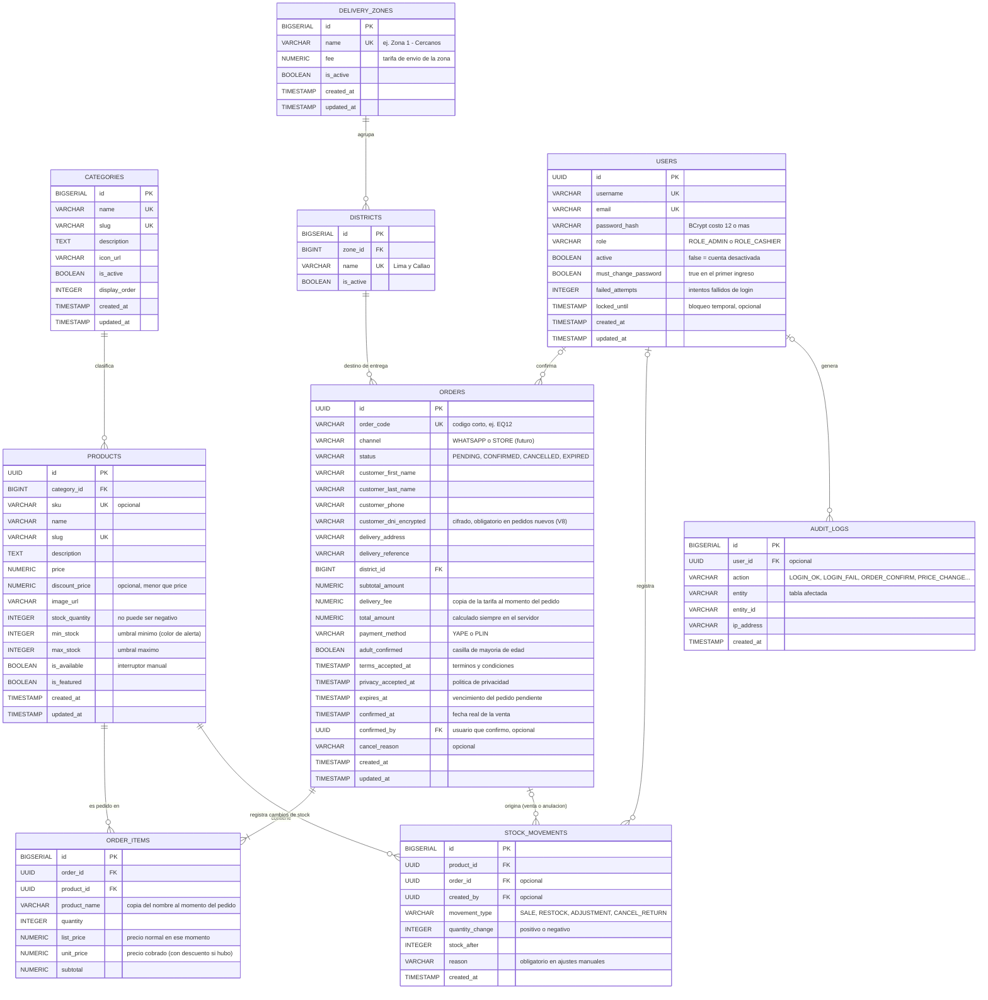

# BRINDA — Contexto completo del proyecto

> Documento de traspaso para continuar el trabajo en Claude Code (CLI).
> Fecha de corte: **2026-10-18**. Estado: diseño cerrado en lo esencial, **implementación sin iniciar**.
> Idioma de trabajo con el desarrollador: **español**.
> Aviso: no soy abogado, contador ni asesor tributario. Todo lo legal/tributario de este documento es orientación y debe validarlo un profesional.

## Índice

0. Cómo usar este documento
1. Resumen ejecutivo
2. Personas y forma de trabajar
3. Alcance y cronología de decisiones
4. Flujo del pedido (paso a paso)
5. Reglas de negocio
6. Modelo de datos (ERD v2)
7. Seguridad
8. Proyecto de referencia: IntelliMarket (el ZIP)
9. Arquitectura propuesta del backend BRINDA
10. Diseño visual
11. Hosting, dominio y cuentas
12. Legal y privacidad
13. Hitos y plan de trabajo
14. Garantía y acuerdos con el cliente
15. Pendientes y preguntas abiertas
16. Cómo explicárselo al cliente
17. Siguiente paso sugerido

---

## 0. Cómo usar este documento

- Leerlo completo antes de escribir código.
- Cada decisión está marcada como **[DECIDIDO]** (acordado con el cliente o con el desarrollador), **[RECOMENDADO]** (propuesta de Claude, el desarrollador no la ha rechazado ni confirmado) o **[PENDIENTE]** (falta una respuesta).
- El código de referencia está en `IntelliMarket-develop2.zip` (trabajo universitario del desarrollador). **No viene dentro de este .md**: si no está en la carpeta del proyecto, pedirlo. Extraerlo siempre en una carpeta aparte y no modificar el original.
- Lo del ZIP fue **leído, no compilado ni ejecutado**. "Funcional" es lo que dice el desarrollador, no algo verificado.

---

## 1. Resumen ejecutivo

**BRINDA** es una licorería de barrio (Lima, Perú) que **aún no tiene local físico**: todo será por **delivery**. Es un trabajo real para un amigo del desarrollador; no se puede fallar.

La web es un **catálogo público y anónimo** (licores, snacks, hielo) con buscador y filtros. El cliente arma un carrito en su navegador, llena sus datos de entrega y presiona "Solicitar". El pedido **se guarda en el servidor con un código corto** (ej. `EQ12`) y luego se abre WhatsApp con el pedido ya redactado. La dueña ve el pedido pendiente en su panel `/admin`, verifica el pago por Yape/Plin en su propia app y presiona "Finalizada": recién ahí se confirma la venta y se descuenta el stock.

- **Stack:** Angular 17+ (SPA) · Java Spring Boot + Spring Data JPA (IntelliJ IDEA) · PostgreSQL (se carga con DBeaver).
- **Sin** pasarela de pagos, **sin** registro de clientes.
- **Plazo pedido por el cliente:** 1–2 semanas, en 2–3 hitos.
- **Poco tiempo de pruebas** (acordado con el cliente): por eso se pide uso real en paralelo antes de depender del sistema.

| Tema | Estado |
|---|---|
| Modelo de datos (ERD v2) | Cerrado [DECIDIDO] |
| Flujo del pedido | Cerrado [DECIDIDO] |
| Hosting recomendado | Propuesto [RECOMENDADO] |
| Dominio | No comprado aún [PENDIENTE] |
| Diseño visual (paleta y fuentes) | Definido; combinación de referencias por confirmar |
| DDL, JPA, seeds, esqueleto del proyecto | **Por hacer** |
| Análisis del ZIP de referencia | Hecho (sección 8) |

---

## 2. Personas y forma de trabajar

- **Desarrollador (usuario):** hace el proyecto solo. Dijo que "olvidó cómo hacer que funcionen" sus proyectos y **sobre todo cómo probarlos en Postman**; va aprendiendo mientras avanza → explicar los pasos, no solo entregar código.
- **Lucía:** dueña de BRINDA, quien usará el panel y atenderá los pedidos. Preferencia clave: **no quiere abrumarse con mensajes**; solo confirmar el pedido y que el pago se efectúe.
- **Su hijo:** co-participante en las reuniones.
- **Contador / asesor legal del cliente:** aún no respondió (ver pendientes).

Preferencias del desarrollador:
- **Mantener la estructura de carpetas y paquetes** de su proyecto anterior (organizada por lo que desarrolla cada módulo).
- **Aplicar la ciberseguridad** que aprendió en su curso (sección 7).
- **No usar tecnologías "arcaicas"** como Excel o cuadernos para llevar ventas; sí quiere poder **descargar datos en CSV** más adelante para verificar cosas.
- Más adelante quiere un **modelo de predicción** con los datos de ventas; por eso importa registrar bien todo desde el día 1.
- La base de datos se sube desde **DBeaver**.
- En una etapa anterior pidió "nada de código por ahora, solo entender el negocio, el diagrama y la seguridad". Ya se pasó esa etapa: el siguiente paso es el DDL y el esqueleto (sección 17).

---

## 3. Alcance y cronología de decisiones

### 3.1 Requisito original
- Cliente anónimo navega, filtra licores/snacks/hielo, busca en tiempo real, agrega a un carrito local.
- "Solicitar" redirige a WhatsApp con el pedido redactado.
- Sin pasarela de pagos ni registro de clientes.
- La dueña entra a `/admin` con credenciales para gestionar el catálogo.
- Escalable: historial de pedidos en BD en una fase 2.0.

### 3.2 Cronología de decisiones

| # | Decisión | Tipo |
|---|---|---|
| 1 | Entidades iniciales: `users`, `categories`, `products`, `orders`, `order_items` | DECIDIDO |
| 2 | Hosting separado en 3 piezas: frontend en CDN, backend dedicado, BD administrada | RECOMENDADO |
| 3 | Referencias visuales: *The Violet Hour* (favorita, elegancia) y *Raising the Bar* (tienda); paleta y fuentes ya definidas | DECIDIDO (paleta/fuentes) |
| 4 | Las cuentas de hosting y dominio **a nombre de Lucía**; el desarrollador entra como colaborador invitado | RECOMENDADO |
| 5 | Stock con cantidades (no solo disponible/agotado) y **alertas de stock bajo dentro de la página**, no por correo (correo = fase posterior) | DECIDIDO |
| 6 | Roles `ROLE_ADMIN` y `ROLE_CASHIER` (el admin también accede a caja) | DECIDIDO |
| 7 | Registrar **cada movimiento de stock** (tabla `stock_movements`) | DECIDIDO |
| 8 | El pedido **se guarda en BD antes de abrir WhatsApp**, con código corto; la dueña lo confirma con un botón "Finalizada" | DECIDIDO |
| 9 | **Sin local físico → solo delivery.** La pantalla de caja (POS) se pospone; el modelo la soporta | DECIDIDO |
| 10 | El formulario web pide nombre, apellido, dirección, celular y DNI; esos datos van también en el mensaje de WhatsApp (para no abrumar a Lucía) | DECIDIDO |
| 11 | El DNI se guarda para emitir **boletas** (no para verificar edad) | DECIDIDO |
| 12 | **Pago único** (productos + delivery) mediante tarifas por distrito/zona | DECIDIDO |
| 13 | BRINDA tendrá su **propia empresa de motorizados** (exclusiva, tarifas fijas) y **luego Rappi**; la web sigue siendo el canal directo | DECIDIDO |
| 14 | ERD v2 (sección 6) | DECIDIDO |
| 15 | Se analizó el ZIP de referencia (sección 8) | HECHO |

### 3.3 Qué entra en la v1 y qué no

**Entra en la v1:**
- Landing + catálogo público con filtros y buscador + carrito local.
- Formulario de datos de entrega + pantalla de confirmación + envío a WhatsApp.
- Pedido guardado con código, estados `PENDING / CONFIRMED / CANCELLED / EXPIRED`.
- Panel `/admin`: catálogo (categorías y productos), stock con colores (mínimo/normal/máximo), lista de pedidos pendientes con confirmar/rechazar, tarifas de zonas.
- Login con roles, auditoría básica, seguridad (sección 7).
- Aviso de mayoría de edad, casillas de términos y privacidad.

**Fuera de la v1 (fases posteriores):**
- Pantalla de caja / POS para ventas presenciales.
- Descarga de CSV y reportes avanzados.
- Alertas por correo.
- Modelo de predicción.
- Guardar pedidos de Rappi (se registrarían a mano cuando llegue Rappi).
- Tabla de clientes.
- Emisión de boletas desde el sistema (se emiten en SUNAT).

---

## 4. Flujo del pedido (paso a paso)

1. El cliente arma su carrito (vive en el navegador, Angular).
2. Llena el formulario: **nombre y apellido, celular (9 dígitos), dirección, referencia, distrito (lista desplegable de Lima y Callao), DNI (ver regla en 5.4), método de pago (Yape o Plin)**, y marca las casillas obligatorias: *mayor de 18 años*, *términos y condiciones*, *política de privacidad* (**sin marcar de antemano**).
3. La página avisa **antes de enviar** que el costo de envío se calcula por zona (estimado).
4. "Solicitar" → `POST` público al servidor. El servidor **valida todo y calcula el total por su cuenta** (nunca confía en precios del navegador), genera el **código corto** y guarda el pedido en `PENDING` con `expires_at`.
5. **Pantalla de confirmación:** muestra el código, el total (productos + envío) y las instrucciones de pago (número/QR de Yape o Plin y monto exacto).
6. Se abre WhatsApp con el mensaje prearmado: código, productos, total, datos del cliente, método de pago. Si el carrito es enorme, el mensaje lleva un resumen (el pedido completo ya está guardado). El número de WhatsApp de destino viene de configuración segura, no del navegador.
7. WhatsApp Business responde automáticamente algo como "Recibimos tu pedido, estamos validando tu pago" (mensaje automático de la app; confirmar que el número de BRINDA pueda usar WhatsApp Business).
8. En el panel, Lucía ve el pedido pendiente: contador, sonido y lista (el panel consulta al servidor cada 10–15 s; un popup puede venir después). SSE/WebSockets quedan para más adelante.
9. Compara el mensaje de WhatsApp con el pedido del panel y **verifica el pago en su propia app de Yape/Plin, nunca con una captura de pantalla** (se pueden falsificar). El total se muestra grande en el panel para comparar rápido.
10. Presiona **"Finalizada"** → el pedido pasa a `CONFIRMED`, se guarda `confirmed_at` (fecha real de la venta, útil para la boleta), se **descuenta el stock** y se escribe el movimiento de stock.
11. Alternativas: **"Rechazar/Cancelar"** (cliente no pagó o se arrepintió) → `CANCELLED` con motivo. Si pasa el tiempo de espera sin confirmar → `EXPIRED` (tarea programada).
12. Lucía contrata el motorizado desde afuera del sistema y usa el botón **"Copiar datos de entrega"** (nombre, dirección, referencia, celular) para pegarlos sin reescribir. También hay **"Copiar datos para boleta"** (nombre, DNI, productos, total).

Notas del flujo:
- **El stock NO se reserva al crear el pedido**; solo se descuenta al confirmar. Al confirmar, el sistema revisa que aún alcance; si otro cliente se llevó la última botella, avisa a Lucía antes de cerrar la venta (puede ofrecer reemplazo por WhatsApp).
- **No hay endpoint público para consultar un pedido por código**: el detalle (con datos personales) solo se ve dentro del panel con login.
- Idea opcional: pedir al cliente que escriba el código en el mensaje del Yape/Plin, **si la app lo permite** (hay que probarlo) para cruzar cada pago con su pedido.
- Mejora opcional: recordar en el navegador del cliente nombre, dirección y celular (**nunca el DNI**).
- No hay estados de reparto (`DISPATCHED/DELIVERED`): el delivery queda fuera del sistema.

---

## 5. Reglas de negocio

### 5.1 Precios y totales
- El servidor calcula siempre `subtotal`, `delivery_fee` y `total_amount`. Dinero en `NUMERIC(10,2)`, nunca `FLOAT`.
- `discount_price` es opcional y debe ser **menor** que `price` (`CHECK`).
- Cada línea del pedido guarda **copia** del nombre, del precio normal y del precio cobrado (`list_price`, `unit_price`), para que el historial no cambie si luego se edita el producto. El pedido guarda copia de la tarifa de envío del momento.

### 5.2 Stock
- `stock_quantity` (no negativo, `CHECK >= 0`), `min_stock`, `max_stock` por producto. Los colores (máximo / normal / mínimo) se calculan con esos umbrales; el desarrollador ya hizo esos colores en su proyecto anterior (frontend; **no lo he visto**).
- `is_available` es un interruptor manual; el stock 0 debe verse como agotado.
- **Todo cambio de stock** escribe una fila en `stock_movements`: tipo (`SALE`, `RESTOCK`, `ADJUSTMENT`, `CANCEL_RETURN`), cambio (positivo/negativo), stock resultante, motivo (**obligatorio en ajustes manuales**), usuario, pedido asociado.
- El descuento debe ser **atómico** (transacción + control de concurrencia): dos ventas simultáneas de la última botella no pueden dejar stock negativo.
- Hace falta una pantalla/endpoint de **reposición** ("llegaron 24 botellas") y cargar el **stock inicial real** antes del lanzamiento (si no, todo parte con datos falsos).
- Alertas de stock bajo: solo dentro de la página (insignia/color en el panel). Correo = fase posterior.

### 5.3 Delivery y tarifas
- BRINDA reparte a **todos los distritos de Lima y Callao**. La casa de Lucía está en **Miraflores**; los vecinos más probables son **Surco, Barranco, San Borja y San Isidro**.
- **Propuesta [RECOMENDADO]:** agrupar los distritos en **3–4 zonas** con una tarifa fija cada una (cercanos / medios / lejanos); Lucía las edita desde el panel. Tablas `delivery_zones` y `districts`.
- La empresa de motorizados exclusiva de BRINDA tiene **tarifas fijas** → se cargan tal cual. Si el repartidor llegara a cobrar más, BRINDA asume la diferencia o ajusta la tabla.
- El cliente paga **todo junto** (productos + envío) en un solo Yape/Plin.
- Rappi llegará después y se maneja aparte (ver 11.5).
- **Pendiente:** nombre de la empresa de motorizados, su lista de tarifas por distrito, y qué pasa con una botella rota o un cliente ausente (poner por escrito en el acuerdo con esa empresa).

### 5.4 DNI y boletas
- Lucía necesita el DNI **para emitir boletas**, no para verificar edad.
- **Recomendación:** DNI **obligatorio siempre** (decisión 2026-10-22; antes: solo sobre S/ 700). Validar solo el formato (8 dígitos); **no consultarlo en servicios externos**.
- Se guarda **cifrado** en BD, se muestra solo a quien lo necesite, **no se escribe en logs** y **no se comparte** con la empresa de reparto.
- El desarrollador quiere guardarlo en BD y que lo use la boleta; **no prometer en la política de privacidad que "nadie lo verá ni se compartirá"**, porque no sería cierto (la boleta se informa a SUNAT, Lucía lo ve en el panel, el proveedor de hosting almacena la BD). Texto sugerido: *"Usamos tu DNI solo para emitir tu comprobante de pago, lo informamos a SUNAT según la ley, lo guardamos cifrado y solo accede el personal autorizado."* (que lo valide su asesor).
- **El sistema no emite boletas ni reemplaza obligaciones con SUNAT.** Las boletas siguen emitiéndose desde SUNAT.
- Por definir con el contador: cuánto tiempo conservar esos datos → define la política de retención (después, anonimizar datos personales y conservar las cifras de venta).

### 5.5 Pagos
- Yape y Plin, confirmados **a mano** por Lucía mirando su app. Sin pasarela, sin tabla de pagos: basta `payment_method` en `orders`.
- No se acepta como prueba una captura de pantalla.

### 5.6 Edad
- Casilla **obligatoria** "Declaro ser mayor de 18 años" + aviso al entrar a la web + se guarda `adult_confirmed` y la fecha/hora de aceptación en cada pedido.
- Los términos y condiciones los **redacta el cliente** (incluyen que no se hacen responsables si un menor causa disturbios). Esa cláusula **no reemplaza** la obligación legal de no vender alcohol a menores → que su asesor revise cómo protegerse.
- El motorizado de una app (Rappi) puede no verificar el documento; la empresa exclusiva sí puede obligarse por escrito a **verificar el documento del receptor antes de entregar** y a no entregar a menores.

### 5.7 Calidad de datos para la predicción futura
Guardar desde el día 1: fecha y hora exactas de la venta (con zona horaria de Perú → usar `TIMESTAMPTZ`), producto, cantidad, precio unitario al vender, método de pago, canal, usuario que confirmó y descuentos/ofertas aplicadas. Reglas:
- **Nunca borrar ventas**: se anulan con motivo y responsable.
- **Registrar quiebres de stock** (si se agota, las ventas caen por falta de producto, no de demanda).
- **Registrar reposiciones**.

### 5.8 Reportes y CSV (fuera de la v1)
Consulta por rango de fechas con producto, cantidad, precio, fecha y demás; botón "Descargar CSV" solo para admin y **registrando quién lo descargó** (contiene datos del negocio).

---

## 6. Modelo de datos (ERD v2)

Archivo ya entregado en la conversación: `erd_licoreria_v2.mermaid` (el v1 era `erd_licoreria.mermaid`). El v2 es el vigente:

### 6.1 Por qué cada decisión del modelo
- **UUID** en `users`, `products` y `orders` (no exponer cuántos hay ni permitir adivinar IDs). **BIGSERIAL** en tablas internas o pequeñas y públicas (`categories`, `delivery_zones`, `districts`, `order_items`, `stock_movements`, `audit_logs`).
- `slug` en categorías y productos para URLs limpias (`/catalogo/whiskys`).
- `display_order` ordena las categorías en el frontend.
- `active` permite desactivar un usuario sin borrarlo. Cuenta del desarrollador: **creada y desactivada por defecto**; Lucía la activa solo cuando haya que arreglar algo.
- `must_change_password`: Lucía cambia su clave en el primer ingreso.
- `failed_attempts` + `locked_until`: bloqueo temporal tras intentos fallidos de login.
- `customer_dni_encrypted`: DNI cifrado, nunca en texto plano. Los datos del cliente viven dentro del pedido (sin tabla de clientes) para limitar datos personales almacenados.
- `terms_accepted_at`, `privacy_accepted_at`, `adult_confirmed`: prueba del consentimiento por pedido.
- `expires_at`: vencimiento automático de pedidos pendientes: **20 min** (`brinda.order.expiration-minutes`; decisión 2026-10-22).
- `confirmed_by`, `audit_logs`: trazabilidad de quién confirmó y quién cambió precios, inició sesión, etc.
- Los roles `ROLE_CASHIER` y `orders.channel = STORE` quedan en el modelo aunque la caja esté fuera de la v1.

### 6.2 Reglas para el DDL (cuando se escriba)
- PK, FK, `NOT NULL`, `UNIQUE`, `DEFAULT`.
- `ON DELETE RESTRICT` en `products.category_id` y en `order_items.product_id` (no borrar categorías con productos ni productos con historial; usar `is_available=false` / `is_active=false`).
- `CHECK (discount_price < price)`, `CHECK (stock_quantity >= 0)`, `CHECK` de precios positivos y cantidades > 0.
- Valores de `status`, `channel`, `payment_method`, `role`, `movement_type` restringidos (`CHECK` o enum).
- Índices: `products(category_id)`, `products(is_available)`, `products(is_featured)` (parcial), `orders(status, created_at)`, `orders(expires_at)` para el job de vencimiento, `order_items(order_id)`, `stock_movements(product_id, created_at)`. Para el buscador en tiempo real con `ILIKE '%texto%'` se **propone** `pg_trgm` con índice GIN sobre `products.name` [RECOMENDADO].
- **Trigger** que actualiza `updated_at` automáticamente.
- Timestamps con zona horaria (`TIMESTAMPTZ`) [RECOMENDADO].
- **Mínimo privilegio:** el usuario de BD que usa Spring tiene solo `SELECT/INSERT/UPDATE` en las tablas necesarias (sin `DROP/ALTER/CREATE`). Las migraciones se corren con otro rol propietario.
- Regla de aplicación: todo pedido nuevo exige DNI (8 dígitos); V8 la refuerza con un trigger de INSERT.

### 6.3 Entregables de datos que siguen pendientes
- Script **DDL completo** para PostgreSQL (DBeaver).
- **Seeds**: al menos 3 categorías (Piscos y Whiskys, Snacks, Hielo/Bebidas), usuario admin con contraseña hasheada con BCrypt, 5 productos de ejemplo para probar con Postman, y la carga de zonas/distritos cuando Lucía entregue las tarifas.
- **Mapeo JPA** (`@Entity`, `@Table`, `@ManyToOne`, `@OneToMany`, `@NotNull`, `@Size`…).

---

## 7. Seguridad

Aplicar lo que el desarrollador aprendió en su curso. Resumen del curso: defensa de red (segmentación, microsegmentación, Zero Trust, IPS contra escaneo de puertos), operaciones de seguridad (estructura de logs: tiempo, ubicación, remitente, acción; telemetría vs alertas; normalización; SPL en SIEM) y automatización con Python (listas, cadenas, funciones, control de flujo, `with open`, `re` para extraer IPs/IDs, depuración). Aplicado a la web:

### 7.1 Autenticación y panel `/admin`
- JWT de vida corta (15–30 min) + refresh con rotación [RECOMENDADO]. **Decidir** entre cookie `HttpOnly + Secure + SameSite=Strict` (recomendada, evita robo por XSS) o cabecera `Authorization: Bearer` (lo que usa el ZIP) [PENDIENTE].
- BCrypt con **costo ≥ 12** (el ZIP usa el valor por defecto, que es más bajo).
- Rate limiting en `/auth/login` (ej. 5 intentos y bloqueo temporal por IP/usuario; Bucket4j o similar), bloqueo de cuenta con `failed_attempts/locked_until`.
- Opcional: 2FA (TOTP) para el admin.
- **Sin registro público.** Los usuarios los crea el admin o un script. El rol nunca lo elige el cliente.
- Cambio de contraseña obligatorio en el primer ingreso.
- Cuenta del desarrollador desactivada por defecto, con conocimiento de Lucía.

### 7.2 Inyecciones y entradas
- Solo consultas parametrizadas / JPA. Si hay `@Query(nativeQuery = true)`, usar `@Param`, **nunca concatenar** el texto del buscador.
- Validación estricta de todo lo que llega (`@Valid`, `@Size`, `@Pattern` en celular/DNI), paginación obligatoria en listados.
- XSS: Angular escapa por defecto; no usar `[innerHTML]` sin `DomSanitizer`; sanear texto libre (`description`, `name`) en backend.

### 7.3 Endpoint público de pedidos (el más delicado)
Es público, sin login y recibe datos personales:
- **Rate limiting por IP** (pocos pedidos por minuto).
- Validar que los productos existan y estén disponibles, cantidades razonables, tamaño máximo del carrito.
- **Total siempre calculado en el servidor.**
- Captcha invisible (Cloudflare Turnstile o hCaptcha) si aparece spam; no hace falta desde el día 1.
- Sin endpoint público para consultar pedidos.

### 7.4 Infraestructura y transporte
- HTTPS obligatorio (Let's Encrypt, automático en los hostings recomendados).
- Cabeceras: `Content-Security-Policy`, `X-Content-Type-Options: nosniff`, `X-Frame-Options: DENY` (evita clickjacking en `/admin`).
- **CORS estricto**: solo los orígenes reales del frontend, nunca `*`.
- Cloudflare (WAF/proxy) delante del sitio para filtrar tráfico anómalo antes de que toque el servidor.
- Secretos solo en variables de entorno del hosting (BD, secreto JWT), nunca en el repositorio.
- El secreto JWT de producción es **distinto** al de local.

### 7.5 Datos personales
- DNI cifrado, acceso por rol, **sin datos personales en logs**, backups protegidos igual, política de retención (sección 5.4).

### 7.6 Errores, logs y auditoría
- **Errores opacos** al usuario ("Ocurrió un error"); trazas solo en logs internos (con un logger real, no `printStackTrace`).
- Registrar intentos de login fallidos y accesos al panel (`audit_logs`), cambios de precio, confirmaciones de pedido y descargas de CSV.
- Escanear dependencias regularmente (`npm audit`, OWASP Dependency-Check). El `pom.xml` del ZIP ya trae el plugin CycloneDX (SBOM): conservarlo.

### 7.7 Reglas operativas
- Confirmar pagos **solo** mirando Yape/Plin; nunca con capturas.
- Verificación en dos pasos en las cuentas de hosting y dominio.
- No compartir contraseñas; el desarrollador entra con su propio correo como invitado.

---

## 8. Proyecto de referencia: IntelliMarket (el ZIP)

`IntelliMarket-develop2.zip` → 119 archivos. Es un **marketplace con varias tiendas**. Stack: Spring Boot 3.4.5, Java 21, PostgreSQL, JWT (jjwt 0.11.5), MapStruct 1.5.5, Lombok, springdoc 2.3.0.

### 8.1 Cómo está ordenado
Organización **por módulo de negocio**; paquete base `com.intellimarket.api`. Cada módulo repite:

`model` · `dto` · `repository` · `service` (interfaz `I...Service` + `...Impl`) · `mapper` (MapStruct) · `controller` · `exception`

Módulos: `auth`, `profile`, `store`, `supplier`, `product`, `inventory`, `order`, `payments`. Además `shared/exception` (`GlobalExceptionHandler`, `ErrorResponse`, `ResourceNotFoundException`, `BusinessRuleException`), `config` (`SecurityConfig`, `CorsConfig`, `OpenApiConfig`, `AppConfig`), `HealthController` y la clase principal.

En la raíz: `Dockerfile`, `.dockerignore`, `docker-compose.yaml`, `render.yaml`, `GUIA-DEPLOY-RENDER.md`, `IntelliMarket_Orders_Postman_Collection.json`, `pom.xml`, `mvnw`/`mvnw.cmd`, `README.md` (solo el título). Recursos: `application.properties`, `application-prod.properties`, `graphql-client/schema.graphql` (**vacío**).

### 8.2 Qué se reutiliza, adapta y descarta

| Pieza | Decisión | Motivo |
|---|---|---|
| Estructura por módulos y capas | Reutilizar | Limpia, mantenible, es lo que el desarrollador quiere conservar |
| `JwtService`, `JwtAuthenticationFilter`, BCrypt, `@EnableMethodSecurity` + `@PreAuthorize` | Reutilizar con arreglos | Base del login del admin |
| `GlobalExceptionHandler`, `ErrorResponse`, excepciones propias | Reutilizar con arreglos | Ya sigue "errores opacos" |
| `Inventory` (stock y `state` calculado en `@PrePersist/@PreUpdate`) | Adaptar | Equivale a `is_available` según stock |
| `InventoryMovement` (SALE, PURCHASE, ADJUSTMENT) | Adaptar | Base de `stock_movements` |
| `Order`/`OrderItem` (precio copiado, total calculado en servidor) | Adaptar | Coincide con el ERD v2 |
| `Dockerfile` multi-stage, `.dockerignore`, perfil `prod` con variables, `server.port=${PORT:8080}` | Reutilizar | Sirve para Railway o Render (el JAR se llama `api-0.0.1-SNAPSHOT.jar`; si cambia el `artifactId`, actualizar) |
| Plugin CycloneDX | Reutilizar | SBOM de dependencias |
| Colección de Postman | Adaptar | Incompleta y desactualizada (8.5) |
| Módulo `profile` (Customer/Owner) | Descartar | BRINDA no tiene clientes registrados |
| Módulo `store` | Descartar | Un solo negocio |
| Módulo `supplier` (Provider, ProviderProduct) | Descartar | Fuera de alcance |
| Módulo `payments` (tarjeta simulada) | Descartar | Yape/Plin se confirma a mano |
| `Cart`/`CartItem` | Descartar | El carrito vive en el navegador |
| Roles `CUSTOMER`/`SELLER` y registro público | Descartar | Pasan a `ROLE_ADMIN`/`ROLE_CASHIER` sin autoregistro |
| Plugin GraphQL del `pom.xml`, `GUIA-DEPLOY-RENDER.md`, devtools | Descartar | GraphQL sin uso; la guía es de otro curso (PagoYa) |

### 8.3 Diferencias de fondo con BRINDA
- **Pedidos exigen usuario logueado** (`orders.user_id` es obligatorio y el carrito está en BD ligado al usuario). BRINDA necesita pedidos **anónimos** con código y datos de entrega → ese flujo se reescribe.
- **El stock se descuenta al crear el pedido** y se devuelve si el pago se cancela. BRINDA lo descuenta **al confirmar**. (La lógica de devolver stock sí se puede reutilizar para anulaciones.)
- **Categorías como enum fijo** (ELECTRÓNICA, ROPA, ALIMENTOS, HOGAR, SALUD, OTROS) → BRINDA necesita tabla `categories` administrable.
- **Topes que bloquean licores:** precio máximo S/ 200 (`@DecimalMax` en la entidad `Inventory` y en `ProductsRequest`), nombre máx. 60 caracteres, descripción máx. 130. Un whisky de S/ 250 se rechazaría y las notas de cata no caben.
- **Umbral de stock crítico fijo en 10** en el servicio → debe ser `min_stock` por producto.
- **Precio duplicado** (`Product.unitPrice` e `Inventory.price`), por el modelo multi-tienda. En BRINDA hay un único precio en `products`.
- **IDs `Long`** (IDENTITY) en el ZIP; el ERD v2 usa UUID en `users`, `products` y `orders`.
- **El estado del pedido se guarda como texto libre** (`"PENDING"`, `"COMPLETED"`, `"FAILED"`); el enum `OrderStatus` existe pero el servicio no lo usa. BRINDA usa `PENDING/CONFIRMED/CANCELLED/EXPIRED`.
- **`ddl-auto=update`** crea tablas desde las entidades. Con DDL propio usar `validate` (o Flyway).
- Lo bueno que sí coincide: el precio se toma del servidor, no del cliente.

### 8.4 Problemas de seguridad detectados en el ZIP (no repetir en BRINDA)
1. **Crear y editar productos y stock sin iniciar sesión:** `SecurityConfig` deja `/api/v1/inventory/**` en `permitAll` para todos los métodos, y `InventoryController` tiene el `POST` y el `PUT` de productos.
2. **Cualquier usuario logueado puede editar cualquier tienda** (`PUT /api/v1/stores/{id}` sin `@PreAuthorize` ni validación de dueño) y hacer todo el CRUD de proveedores (`SupplierController` sin `@PreAuthorize`).
3. **Registro público con rol elegido por el cliente** (`RegisterRequest.role`): cualquiera se registra como `SELLER`.
4. **Secretos en el repo:** contraseña de BD y secreto JWT escritos en `application.properties` (el `docker-compose.yaml` también trae credenciales; esas son solo de desarrollo local).
5. **CORS en producción:** en `application.properties` la línea que lee `CORS_ALLOWED_ORIGINS` está comentada y el valor fijo es `http://localhost:4200`; `application-prod.properties` no lo sobrescribe. Con los archivos entregados, producción bloquearía al frontend real. `ProfileController` además tiene un `@CrossOrigin` suelto con `https://localhost:4200`.
6. **Token vencido o mal formado:** `JwtAuthenticationFilter` no captura la excepción; ocurre antes del `GlobalExceptionHandler`, por lo que **probablemente** devuelve 500 en vez de 401 (no lo probé).
7. **Sin rate limiting** (no hay dependencia para ello en el `pom.xml`).
8. **Swagger abierto en producción** (`permitAll`), y `logging.level.org.springframework.web=DEBUG` aplica también en producción.
9. **`sslmode=disable`** en la URL JDBC de producción. Neon o Supabase exigen SSL.
10. **Sin control de concurrencia:** no hay `@Version` ni bloqueos en ningún archivo. Riesgo de stock incorrecto con ventas simultáneas.
11. **Las ventas no registran movimiento de inventario:** solo `createProduct` guarda un `PURCHASE`; el checkout, la devolución por pago cancelado y `updateProduct` no escriben movimientos.
12. **Menores:** `printStackTrace()` y `System.out.println` en lugar de logger; `HealthController` en `/` dice "conectada a PostgreSQL" sin comprobarlo; el Dockerfile corre como root; solo hay un test (`contextLoads`, que necesita BD); el secreto JWT se decodifica como **Base64** (`Decoders.BASE64`), así que el de producción debe generarse con `openssl rand -base64 64`; el secreto local contiene `!`, que no es del alfabeto Base64 (no probé si el decoder lo tolera); existe la propiedad `refresh-expiration-ms` pero **no hay endpoints de refresh ni logout** (solo `register` y `login`); `springdoc 2.3.0` es de la línea de Boot 3.2 → verificar compatibilidad con Boot 3.4.5.

### 8.5 Postman (de la colección del ZIP)
- Nombre: *IntelliMarket API - Full Collection*. Variables: `base_url = http://localhost:8080` y `token`.
- Carpetas: Auth (registrar cliente, registrar vendedor, login), Profiles, Stores, Orders & Cart, más un Health Check.
- El script de Login guarda `jsonData.token` con `pm.environment.set`; el campo `token` sí coincide con `AuthResponse`. **Requiere tener un Environment seleccionado en Postman** (si no, el token no se guarda).
- **Rutas desactualizadas:** la colección llama `/api/orders/...` y el controlador real es `/api/v1/orders/...` → esas pruebas fallan.
- No cubre inventario, pagos, proveedores ni los `PATCH/DELETE` del carrito.
- Usuarios de prueba de la colección: `customer@test.com` y `seller@test.com`, clave `123456`.
- Para BRINDA: colección nueva con **una prueba por regla de seguridad** (ej.: "crear producto sin token → 401", "cajero cambiando precio → 403", "pedido con precio manipulado → el servidor recalcula", "demasiados pedidos seguidos → 429").

### 8.6 Cómo levantar el proyecto de referencia (según los archivos; no probado)
1. Levantar Postgres local con `docker-compose.yaml` (puerto **5433**, BD `mydatabase`, usuario `myuser`, clave `secret`). En `application.properties` está `spring.docker.compose.enabled=false`, así que hay que arrancarlo a mano.
2. Ejecutar la app con el perfil por defecto `local` (Maven wrapper `mvnw spring-boot:run`, o desde IntelliJ).
3. Swagger en `/swagger-ui.html`; health en `/`.
4. En Postman: seleccionar un Environment, correr Register → Login (guarda el token) → el resto.

---

## 9. Arquitectura propuesta del backend BRINDA

Misma forma que el ZIP, contenido nuevo (paquete base a definir, p. ej. `com.brinda.api`):

| Módulo | Contenido |
|---|---|
| `auth` | Login, JWT, usuarios admin/cajero, bloqueo por intentos, cambio de clave. **Sin registro público.** |
| `catalog` | Categorías y productos (CRUD admin; lectura pública con filtros, búsqueda y paginación) |
| `inventory` | Stock, umbrales min/max, reposición, ajustes, movimientos |
| `order` | Creación pública con código, confirmar/rechazar/expirar, copia de datos para entrega y boleta |
| `delivery` | Zonas, distritos y tarifas (editables por admin) |
| `shared` | Excepciones, auditoría, utilidades |
| `config` | Seguridad, CORS por variable de entorno, rate limiting, Swagger solo en local |

Notas de implementación:
- Transacciones y bloqueo (pesimista u optimista con `@Version`) en confirmación de pedidos y movimientos de stock.
- Tarea programada (`@Scheduled`) para pasar `PENDING` vencidos a `EXPIRED`.
- Endpoint admin liviano para el contador de pendientes (polling cada 10–15 s).
- Perfil `local` / `prod`; en producción: `ddl-auto=validate`, SSL a la BD, sin Swagger público, logs sin `DEBUG`, CORS por variable de entorno.
- Usar un logger real y un `GlobalExceptionHandler` que también maneje 401/403 y errores del filtro JWT.

---

## 10. Diseño visual

### 10.1 Referencias
- **The Violet Hour** (theviolethour.com): bar de coctelería en Chicago, sitio en Squarespace, *one-page*, fondo oscuro, logo centrado, fotos grandes y atmosféricas, navegación mínima (HOME, RESERVE, MENU, CLASSES & TO-GO, INFO, PRIVATE EVENTS & CATERING, THE BARTENDER'S MANIFESTO). **Es la favorita del cliente (elegancia).** Su fuerza: sobriedad, espacio en blanco, una acción principal.
- **Raising the Bar** (weareraisingthebar.com): tienda Shopify de cajas de cócteles sin alcohol. Header fijo con botón tipo píldora, banner superior de anuncio, grid de productos con "Add to Cart" directo desde la tarjeta, sección "cómo funciona" en 3 pasos, testimonios con fotos, newsletter con captcha (hCaptcha). **Referencia del lado tienda.** No aplica su checkout.

### 10.2 Propuesta híbrida [RECOMENDADO, por confirmar con el cliente]
- **Landing oscura y elegante** (Violet Hour): hero con foto atmosférica, fondo marrón medianoche, dorado como acento, un CTA principal ("Ver catálogo" / "Pedir por WhatsApp").
- **Catálogo claro y limpio** (Raising the Bar): fondo crema/marfil porque las botellas se ven mejor y un catálogo oscuro cansa la vista; tarjetas con imagen, nombre, precio y botón "+" directo; **filtros por categoría visibles** (píldoras) y **buscador visible** arriba del grid.
- **Sección "cómo pedir"** en 3 pasos (elige → agrega → pide por WhatsApp).
- Carrito flotante siempre visible con contador y botón "Solicitar".
- Insignia "Destacado" (`is_featured`) en dorado ámbar, sin banners ruidosos.
- Etiquetas de promo en terracota; sección de contraste (combos, hielo) en verde azulado.
- Opcional: testimonios reales (genera confianza), ubicación/zonas de reparto y horarios.
- **Aviso de mayoría de edad al entrar.**

### 10.3 Paleta (proporción 60 / 30 / 10)

| Rol | Color | Hex |
|---|---|---|
| Fondo principal (60%) | Marrón medianoche | `#431821` |
| Secciones alternas | Ciruela profundo | `#4B1E3A` |
| Texto y secciones claras (30%) | Crema / Marfil | `#FBF4E1` / `#FFF8ED` |
| Líneas, íconos, detalles "latón" (10%) | Dorado ámbar | `#B2864F` |
| Botones CTA | Burdeos Brinda | `#A1163B` |
| Etiquetas de promo | Terracota | `#CA5A4E` |
| Sección de contraste (combos, hielo) | Verde azulado | `#00585E` |
| Texto secundario sobre claro | Gris piedra | `#7D7267` |
| Extra de la paleta | Rosa empolvado | `#D9A38F` |

Nombres de la hoja de swatches: Burdeos Brinda, Marrón medianoche, Crema Brinda (`#FBF4E1`), Dorado ámbar, Terracota rojizo, Verde azulado profundo, Ciruela profundo, Marfil cálido (`#FFF8ED`), Rosa empolvado, Gris piedra cálido.

### 10.4 Tipografías
- **Títulos:** Libre Baskerville Bold/Italic.
- **Acento:** Limelight, **solo en 1 o 2 palabras**.
- **Texto:** Jost.

---

## 11. Hosting, dominio y cuentas

### 11.1 Arquitectura recomendada [RECOMENDADO]
Separar en 3 servicios, no todo en un solo servidor:

| Pieza | Dónde | Por qué | Costo aprox. |
|---|---|---|---|
| Frontend Angular (SPA) | Vercel o Netlify | CDN global, archivos estáticos muy rápidos, sin *cold start* | Gratis a este tamaño |
| Backend Spring Boot | Railway (o Render de pago) | Deploy con Docker, buen soporte JVM, logs claros | ~US$5–7/mes |
| PostgreSQL | Supabase o Neon (o el Postgres de Railway) | Administrado, backups, se conecta con DBeaver | Plan free suficiente para este volumen |

- **Evitar el plan gratuito del backend:** duerme tras ~15 min sin tráfico y la primera petición tarda 30–60 s (*cold start*). Para una tienda eso hace que el cliente cierre la pestaña.
- Un VPS único (DigitalOcean, Hostinger VPS…) es más barato en teoría, pero obliga a configurar Nginx, SSL, Docker, firewall, backups y reinicios a mano. No conviene con este plazo.
- **Los precios cambian seguido** (en la búsqueda vi información contradictoria entre meses). Confirmar en render.com/pricing, railway.com/pricing y vercel.com/pricing antes de cotizar.
- Costo recurrente estimado: **US$5–10/mes** + renovación anual del dominio.

### 11.2 Dominio (aún no comprado) [PENDIENTE]
Importa el precio de **renovación**, no el del primer año (precios vistos en búsquedas de octubre de 2026; **verificar el día de la compra**):

| Registrador | `.com` | Comentario |
|---|---|---|
| **Porkbun** | US$11,08/año (registro y renovación) | **Primera opción**: simple, WHOIS gratis, pocas ventas adicionales |
| **Cloudflare Registrar** | ~US$10,46 (precio mayorista) | Más barato a largo plazo; DNS pasa por Cloudflare; panel más técnico; menos extensiones |
| **Namecheap** | US$11,28 primer año / US$18,48 renovación | Amigable para principiantes; cuidado con la renovación |
| GoDaddy / Hostinger | Ofertas de primer año muy bajas | Renovaciones bastante más caras; revisar siempre el precio de renovación |

- **`.com` mejor que `.pe`:** más fácil de dictar y funciona con todo. El `.pe` ronda 52 € al año en algunos registradores y 59–63 € + IVA en otros (≈5 veces más caro). Se puede comprar el `.pe` después como protección de marca.
- Al comprar: **cuenta de Lucía**, correo que revise a diario, **verificación en dos pasos**, **renovación automática** con tarjeta vigente, **privacidad WHOIS** activada, tarjeta que acepte **pagos internacionales en dólares** (suele ser el primer obstáculo en Perú).
- Nombre **corto, sin guiones ni tildes**, fácil de dictar por teléfono; revisar que esté libre en Instagram y TikTok; consultar disponibilidad como marca en **INDECOPI** (con quien corresponda).
- Antes de pagar, que le pasen el nombre al desarrollador para revisarlo juntos: un dominio mal escrito no se corrige, solo se compra otro.

### 11.3 Conectar el dominio al deploy
1. Subdominios: `tudominio.com` y `www.tudominio.com` → frontend; `api.tudominio.com` → backend.
2. En Vercel/Netlify (sección *Domains*) y en Railway/Render (*Custom Domain*): agregar el dominio y copiar los registros **CNAME/A** que indiquen al panel DNS del registrador.
3. HTTPS (candadito) se genera automáticamente y gratis.
4. Esperar la **propagación DNS**: de 10 min a unas horas (a veces hasta 24–48 h). **No dejarlo para el último día antes de una demo.**
5. Actualizar **CORS** en Spring con los orígenes exactos (`https://tudominio.com`, `https://www.tudominio.com`), sin `*`.
6. **Variables de entorno de producción** configuradas en el panel del hosting (`SPRING_DATASOURCE_URL`/equivalentes, usuario y clave de BD, secreto JWT, CORS), nunca en el repo.

### 11.4 Cuentas y accesos
- **Titular: Lucía**, con su correo y su tarjeta. El desarrollador entra como **colaborador invitado** con su propio correo; nunca compartir la contraseña de Lucía. Verificar en cada servicio si el plan gratuito permite invitar colaboradores.
- Usar el **correo personal que ella revisa de verdad** (Gmail), **no uno del dominio** (`lucia@brinda.com`): si el dominio vence o el DNS falla, perdería el correo justo cuando lo necesita para recuperarlo. Un `contacto@dominio` de cara al cliente, con reenvío al Gmail, es opcional y puede esperar.
- Un pago fallido que nadie ve apaga la página: por eso el correo debe ser uno que se revise a diario y con tarjeta vigente.
- Dentro de la web, el admin de Lucía lo crea el desarrollador con el correo de ella; el del desarrollador queda desactivado.
- Entregar a Lucía una **guía escrita**: qué cuentas existen, para qué sirve cada una y cuándo se renuevan.
- Los datos del negocio (catálogo, precios, fotos, ventas, usuarios) y el dominio son **del cliente**; si quiere cambiar de desarrollador, solo le quita el acceso.

### 11.5 Rappi (llegará después) y delivery
- BRINDA estará en Rappi, pero **tardará**; mientras tanto la web sigue en pie como canal directo y sin comisión.
- Un pedido hecho **dentro de la app de Rappi** nunca pasa por la web ni por WhatsApp: vive en Rappi y Lucía lo atiende desde su panel de Rappi.
- Rappi pide **documentos que prueben que el negocio es legal y que tiene los permisos**, un **menú con precios fijos antes de activar la cuenta**, y que se indique si se trabaja con otras empresas de domicilios. **Por preguntar a Rappi:** punto de recojo (no hay local), comisión, si los precios serán los mismos que en la web, protocolo de verificación de edad en Perú (en Colombia sus repartidores deben comprobar el documento; el de Perú no lo pude confirmar) y si permite usar sus repartidores para pedidos que no vengan de su app (**no lo pude confirmar**).
- **Stock compartido:** Rappi y la web no sincronizan inventario → riesgo de vender dos veces lo mismo. Solución simple al inicio: Lucía **registra a mano las ventas de Rappi** en el panel (con la pantalla de venta manual prevista para después). Revisar más adelante si Rappi ofrece integración (no confirmado).
- Lucía dijo sobre Rappi: si la botella se rompe en el reparto, ella habla con la empresa; si el cliente no está para recibir, es tema de Rappi. Para **su propia** empresa de motorizados, ese acuerdo está pendiente.

---

## 12. Legal y privacidad

Orientación, no asesoría legal:
- **Ley 29733** de protección de datos personales. Su nuevo reglamento (**DS 016-2024-JUS**) reemplazó al de 2013 y entró en vigencia a fines de marzo de 2025 (según lo encontrado en búsqueda).
  - Todo tratamiento requiere consentimiento **previo, libre, expreso e inequívoco**: casilla **sin marcar de antemano** + política de privacidad en lenguaje claro, **como documento/sección propia** (no escondida dentro de los términos).
  - Si ocurre un incidente de seguridad que cumpla las condiciones del reglamento, hay que **notificarlo a la autoridad dentro de 48 horas**.
  - Las microempresas con ventas anuales de hasta 150 UIT tienen un plazo de adecuación más largo (cuatro años desde la publicación); aun así, conviene hacerlo bien desde el inicio.
  - La inscripción de bancos de datos ahora es gratuita y de aprobación automática; preguntar al asesor si les corresponde.
- La política de privacidad debe **mencionar que se comparten los datos de entrega** (nombre, dirección, celular) **con la empresa de reparto**, solo para entregar. El DNI no se comparte con ella.
- **Términos y condiciones:** los redacta el cliente. Dos apuntes: (1) el consentimiento de datos va aparte; (2) la cláusula "no nos hacemos responsables si el cliente es menor" no reemplaza la obligación legal de no vender alcohol a menores (que hasta donde sé existe en Perú) → que su asesor revise cómo protegerse. Del lado técnico: casilla obligatoria de mayoría de edad, aviso al entrar y registro de fecha/hora de aceptación en cada pedido.
- **Boletas/SUNAT:** el sistema no las emite ni reemplaza obligaciones; la emisión sigue en SUNAT. DNI obligatorio siempre (sin umbral).
- **Pendiente de revisar con asesor** (no confirmado por mí): restricciones municipales de horario de venta de alcohol (varían por distrito), reglas de publicidad de alcohol, y si hace falta licencia de funcionamiento para operar solo en línea sin local (una guía consultada indica que no en un primer momento, pero depende del municipio del domicilio fiscal).

---

## 13. Hitos y plan de trabajo

El cliente quiere 1–2 semanas. **Con una semana habría que recortar.** El tiempo real depende de **qué tan rápido entreguen fotos, lista de productos y stock inicial**; si llegan tarde, el plazo se corre (dejarlo por escrito).

| Hito | Contenido | Tiempo estimado |
|---|---|---|
| **1** | Base de datos (DDL + seeds), backend: login y roles, catálogo, stock y movimientos, pedido público con código, confirmar/rechazar/expirar, zonas de delivery, auditoría, rate limiting; todo probado en Postman | Días 1–4 |
| **2** | Frontend: landing, catálogo con filtros y buscador, carrito local, formulario y confirmación, envío a WhatsApp; panel admin (catálogo, stock con colores, lista de pedidos pendientes, tarifas de zonas) | Días 4–9 |
| **3** | Endurecimiento de seguridad, deploy, dominio, política/términos publicados, uso real en paralelo (2–3 días con productos reales desde el celular de Lucía). CSV/reportes solo si hay margen | Días 9–14 |

- Es una de las pocas partes donde **un error cuesta dinero real** (inventario y ventas) y casi no habrá tiempo de pruebas → el uso real en paralelo es la red de seguridad: comparar lo que dice el sistema con el stock real antes de depender de él.
- Cargar el stock inicial **contando el inventario real** antes del lanzamiento.

---

## 14. Garantía y acuerdos con el cliente

No soy abogado; los montos los decide el desarrollador según su mercado.
- **Periodo de garantía de 15–30 días** para corregir errores de lo acordado en los hitos.
- **Definir por escrito qué es un "bug":** algo que no funciona como se acordó. **Quedan fuera:** funciones nuevas, cambios de diseño o textos, caídas de servicios de terceros (Railway, Vercel, Rappi…) y errores causados por cambios que haga el cliente.
- **Tiempos de respuesta:** por ejemplo, urgentes el mismo día y el resto en 48 horas.
- **Después de la garantía:** tarifa por hora o plan mensual pequeño de mantenimiento.
- **Cerrar el alcance por escrito** (qué entra en la v1 y qué queda para después), una **fecha límite para recibir el material**, una **persona de contacto única** para aprobaciones y el **titular** de las cuentas.
- Ponerlo todo en un mensaje o documento corto cuida la amistad.

---

## 15. Pendientes y preguntas abiertas

### Con el contador / asesor
- [ ] Cuánto tiempo conservar el DNI y demás datos personales.
- [ ] Cómo protegerse con la verificación de mayoría de edad en el delivery de alcohol.
- [ ] Restricciones municipales de horario y publicidad de alcohol; licencia de funcionamiento para operar sin local.
- [ ] ¿Les corresponde inscribir un banco de datos personales?

### Con Lucía
- [ ] **Empresa de motorizados:** nombre, lista de tarifas por distrito o zona, y acuerdo sobre botella rota y cliente ausente; que se obliguen por escrito a verificar el documento del receptor.
- [ ] **Zonas:** cuántas y qué distrito va en cada una (propuesta 3–4 zonas).
- [x] Minutos de espera antes de que un pedido pase a `EXPIRED`: 20.
- [ ] Umbral de **stock bajo**: ¿mismo número para todos o por producto (el hielo se agota antes que un whisky caro)?
- [ ] ¿Quién cuenta el **inventario inicial**? ¿Cómo manejan cajas vs unidades sueltas?
- [ ] **Logo** en alta calidad, **slogan** (si no, se proponen 3 opciones), redes sociales, qué quiere ver en la landing.
- [ ] **Fotos** del local/marca y de cada producto (mínimo ~800×800 px, estilo parecido; no bajarlas de Google por derechos de autor: pedirlas a distribuidores o fotografiarlas) y la **lista de productos** con nombre, categoría, precio y presentación; ¿cuántos productos son (50, 200, 500)?
- [ ] Número de **WhatsApp** (¿Business?), quién lo atiende, **formato del mensaje**, números/QR de **Yape y Plin**, horarios de atención, monto mínimo de pedido (si habrá).
- [ ] ¿Aprueban el **híbrido** de diseño (landing oscura + catálogo claro) o prefieren un solo estilo?
- [ ] **Textos legales** (términos y política de privacidad) redactados por ellos.
- [ ] **Titular de las cuentas**, correo que revisan a diario, tarjeta con pagos internacionales en USD, **nombre del dominio** y dónde comprarlo (Porkbun recomendado).
- [ ] Fecha límite de entrega de material y persona de contacto única.
- [ ] Rappi (más adelante): documentos, punto de recojo, comisión, precios, protocolo de edad en Perú.

### Técnicas (del desarrollador / de Claude)
- [ ] Decidir **cookie HttpOnly vs cabecera Bearer** para el JWT.
- [ ] Probar si Yape/Plin permite escribir el código del pedido en el mensaje.
- [ ] Confirmar que el número de BRINDA puede usar **WhatsApp Business** (mensaje automático).
- [ ] Confirmar que los planes gratuitos elegidos permiten **colaboradores invitados**.
- [ ] Verificar precios actuales de hosting y dominio antes de cotizar.
- [ ] Definir el paquete base del backend (p. ej. `com.brinda.api`).
- [ ] Decidir si se usa Flyway para migraciones (recomendado) junto con `ddl-auto=validate`.

---

## 16. Cómo explicárselo al cliente

Analogías ya usadas (el cliente no sabe de tecnología):
- **La vitrina** (lo que ve el cliente) vive en Vercel/Netlify: como alquilar un espacio en un centro comercial que siempre está abierto.
- **CDN:** copias de la vitrina en muchos lugares del mundo → abre rápido desde cualquier celular, como tener una sucursal en cada barrio.
- **El encargado** (sabe qué productos hay, cuánto cuestan y quién puede entrar) vive en Railway/Render: una oficina donde trabaja 24 horas sin dejar una computadora prendida.
- **El cuaderno de inventario** (la base de datos): guarda productos, precios, ventas y movimientos, con copias de seguridad automáticas (una fotocopia del cuaderno en otro lugar).
- **La dirección** es el dominio, como la dirección del local.
- **"Los datos son suyos":** las cuentas están a su nombre; el desarrollador es un invitado, como el electricista al que se le dan las llaves para trabajar, y se las pueden quitar cuando quieran.
- **Por qué el código del pedido:** el mensaje de WhatsApp lo puede editar el cliente; la versión oficial es la que queda guardada en el sistema.
- **Regla de oro del pago:** el sistema no puede saber si el pago llegó; se confirma mirando Yape/Plin, nunca con capturas.

---

## 17. Siguiente paso sugerido

**Hito 1, en este orden:**
1. Extraer el ZIP de referencia en una carpeta aparte y tenerlo a mano (sección 8).
2. Escribir el **DDL de PostgreSQL** según el ERD v2 (reglas de la 6.2), con trigger de `updated_at`, índices y rol de aplicación con mínimo privilegio.
3. Escribir los **seeds** (3 categorías, admin con BCrypt, 5 productos).
4. Crear el **esqueleto del proyecto BRINDA** copiando la estructura de módulos de IntelliMarket (sección 9), con `ddl-auto=validate`, perfiles `local`/`prod` y secretos por variables de entorno.
5. Implementar `auth` y `catalog` primero, con seguridad desde el inicio (rutas públicas solo de lectura del catálogo y creación de pedidos).
6. Armar la **colección de Postman nueva** con una prueba por regla de seguridad y explicar al desarrollador cómo correrla.

Cosas que **no** hacer: dejar el plan gratuito en el backend; exponer Swagger público en producción; subir secretos al repo; permitir registro público o que el cliente elija su rol; descontar stock al crear el pedido; aceptar capturas de pantalla como prueba de pago; prometer que "nadie verá el DNI"; copiar imágenes de Google.

---

## 18. Lote V4 (ofertas, combos, promociones y ajustes) · decisiones

Implementado en el backend (migraciones `V4` a `V7`). Decisiones acordadas:

- **Ocultar vs. agotado:** ocultar = `is_available = false` (el producto desaparece del catálogo público y su detalle da 404; sigue en el panel y el historial). Agotado = stock 0 con `is_available = true`: sigue visible, marcado sin stock y no se puede pedir; ocurre solo.
- **Orden del catálogo:** con stock primero, luego con promoción activa (oferta de precio o "lleva N paga M"), luego combos, luego destacados, luego nombre; desempate por id. Filtro `onOffer=true`.
- **Recepción de mercadería:** reposición por lote (máx. 100 líneas, todo o nada), un movimiento `RESTOCK` por línea y una auditoría por lote.
- **Ofertas de precio:** mismo producto, mismo stock, **fecha y hora de fin obligatoria y futura**. Se evalúan por fecha al consultar (sin tareas programadas). Un pedido pendiente conserva su precio aunque la oferta venza antes de confirmarlo. La línea del pedido guarda `promo_type = 'OFFER'`.
- **Combos pre-armados:** un combo es un producto con stock propio y **composición fija** (no se edita; para otro contenido se crea otro combo; sin combos dentro de combos). Armar N combos resta `N × cantidad` de cada componente (`COMBO_CONSUME`, con `combo_id`) y suma N al combo (`COMBO_BUILD`); **no es venta**. Se vende y se anula por el flujo normal de pedidos. Desarmar queda para después (los tipos `COMBO_DISASSEMBLE` y `COMBO_RETURN` ya están permitidos en la base).
- **"Lleva N, paga M"** (2x1, 3x2): sobre el mismo producto, fecha de fin obligatoria, excluyente con la oferta de precio (incluso en combos; también lo exige la base). Cálculo: `grupos = floor(q/N)`, `gratis = grupos × (N−M)`, `descuento = gratis × precio`. El **stock baja por todas las unidades entregadas**. El total del pedido usa el subtotal ya descontado. La línea guarda `promo_type = 'BUY_X_PAY_Y'`, `promo_discount` y N/M (solo si el descuento aplicó; con menos de N unidades no hay descuento ni marca de promoción).
- **Seed de desarrollo** (`database/seed-dev`) solo corre con el perfil `local`; zonas y distritos son datos de referencia en `V4`. La categoría "Combos y promociones" va en `V6`.
- **Auditoría con detalle** (`audit_logs.details`, valor anterior → nuevo, sin datos personales).
- **Privilegios de `brinda_app`**: `setup/02_grants.sql` es la fuente única y se reaplica sola como callback `afterMigrate` (solo concede y revoca lo que la app nunca debe tener; sin ventana de `permission denied` entre instancias).
- **Protecciones del seed en producción:** test que rompe el build si `db/migration` trae el seed; con perfil `prod` la app no arranca si existe `admin@brinda.local`. Los builds de release usan `mvn clean package`.

## 19. Pendientes antes de producción (no implementar ahora)

1. **IP real detrás del proxy:** `ClientIp` usa `getRemoteAddr()` y el comentario asume que `forward-headers-strategy=framework` lo corrige; no está confirmado. Probar en staging y, si hace falta, usar la estrategia `native` con proxies de confianza. Si no, el límite de 5 pedidos por minuto se compartiría entre todos los clientes.
2. **Crear la cuenta real de la dueña** (script o endpoint) y desactivar la del seed.
3. ~~Umbral de S/ 700 para DNI~~ — **resuelto en V8**: DNI obligatorio siempre, sin umbral. Los pedidos previos sin DNI (solo existen en bases de desarrollo) quedan como están.
4. **`DNI_ENCRYPTION_KEY`:** respaldarla aparte; no hay rotación. Perderla deja los DNI ilegibles.
5. **Rol de cajero para el hijo:** hoy todo el panel exige `ROLE_ADMIN`.
6. **Fotos de productos:** hoy solo `image_url`, sin subida de archivos. Decidir dónde viven.
7. **Cookie `SameSite=Strict`:** requiere dominio propio con frontend y API como subdominios del mismo sitio; con `*.vercel.app` y `*.railway.app` la sesión no se mantendría.
8. **Bloqueo de cuenta por intentos:** el usuario `admin` es fácil de adivinar y se puede bloquear a la dueña. Usar un nombre de usuario menos obvio y mantener el límite por IP.
9. ~~Sesión sin invalidación~~ — **resuelto (V9 `users.token_version`):** logout y cambio de clave invalidan los tokens anteriores. Sigue sin refresh token (decisión consciente; sesión de 8 h).
10. **Sin captcha en pedidos;** el límite por IP está en memoria (se reinicia con la app).
11. **No se registran los pedidos rechazados por falta de stock** (demanda perdida).
12. **Pendientes funcionales:** desarmar combos, ofertas programadas con fecha de inicio, promociones que mezclan productos.
13. **Validar con el asesor:** publicidad y venta de cigarros y alcohol en un catálogo en línea.
14. **Sin tests automáticos de integración;** solo unitarios (regla de oferta, promoción, `buildableNow`, cálculo "lleva N paga M", textos de línea, guarda del seed).
15. **No subir `backend/.env` ni compartirlo;** usar claves nuevas (`JWT_SECRET`, `DNI_ENCRYPTION_KEY`, contraseñas de base) en producción.
16. **Tarifas y distritos de `V4` son provisionales** hasta tener la lista real de la dueña.
17. ~~Mensaje de WhatsApp y boleta sin contenido de combos~~ — **resuelto:** la línea del combo añade "(incluye: 2 x Whisky X, 1 x Gaseosa)". El resumen corto de WhatsApp (pedidos largos) no lo lleva.
18. **Libro de reclamaciones virtual:** formulario público (datos del consumidor, bien contratado, tipo reclamo/queja, detalle, pedido del consumidor), tabla `complaints` con correlativo y fecha, aviso por correo/WhatsApp a Lucía al registrarse, hoja de reclamación al consumidor y plazo de respuesta (30 días). Confirmar requisitos exactos con el asesor.
19. **Política de privacidad con casilla de aceptación en el checkout:** el backend ya exige `privacyAccepted` y guarda `privacy_accepted_at`; falta redactar la política (finalidad, plazo de conservación del DNI, derechos ARCO), publicarla y enlazarla en el checkout.
20. ~~Casilla "soy mayor de 18"~~ — **resuelto en backend:** `adultConfirmed` es obligatorio en `POST /orders` y se guarda en `orders.adult_confirmed`. Frontend: mostrar la casilla en el checkout; si el asesor pide otro texto o un aviso en el catálogo, solo cambia la interfaz.
21. **Fotos: subida desde el panel** (diferida; hoy carga manual con `database/templates/update_image_urls.sql` e `IMAGES_BASE_URL`). Al hacerlo: multipart, validar tipo por contenido (no por extensión/Content-Type) y tamaño máximo, convertir a WebP, guardar en almacenamiento compatible con S3 (R2) y dejar la ruta relativa en `image_url`.
